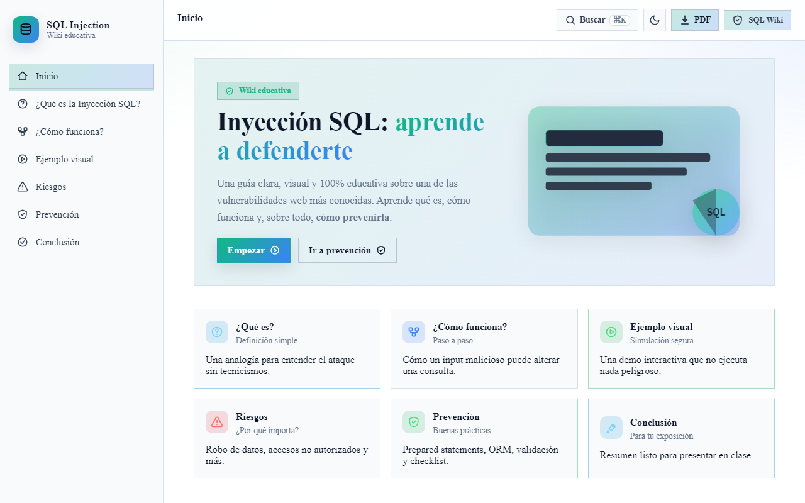

# 🛡️ SQL Injection Wiki

[](https://github.com/Fernandamv96/Wiki-Inyecci-n-Sql-/actions/workflows/ci.yml)


[](LICENSE)

> Wiki educativa sobre **Inyección SQL**: qué es, cómo funciona, ejemplos, riesgos y, sobre todo, cómo prevenirla. Pensada para estudiantes principiantes y para presentaciones universitarias.

**Demo:** <https://wiki-inyecci-n-sql-c96e.vercel.app>



## ¿Qué problema resuelve?

La inyección SQL se explica casi siempre con código que asusta a quien empieza. Esta wiki la explica con analogías, una simulación **que no ejecuta nada** y un checklist de prevención, para entender el riesgo antes de tocar un laboratorio.

## ✨ Características

- 🎓 **7 secciones** educativas (Inicio, ¿Qué es?, ¿Cómo funciona?, Ejemplo visual, Riesgos, Prevención, Conclusión).
- 🧪 **Simulación segura** con **6 payloads** clásicos y **desglose token a token** (bypass de auth, comentario, UNION SELECT, DROP TABLE, boolean blind).
- 🔎 **Búsqueda global** con `Ctrl/Cmd + K` que indexa todas las secciones.
- 📄 **Exportación a PDF** de toda la wiki.
- 🌗 **Modo claro / oscuro** con persistencia.
- ✅ **Checklist interactivo** de buenas prácticas con barra de progreso.
- 📱 Responsive (móvil, tablet y escritorio).

## Stack

React 18 · Vite · CSS propio · Vercel

## Cómo correrlo localmente

El código está en la carpeta `sql-injection-wiki/` (en Vercel, **Root Directory** = `sql-injection-wiki`):

```bash
cd sql-injection-wiki
npm ci
npm run dev       # http://localhost:5173
npm run lint      # ESLint
npm run build     # build de producción
```

## Estructura del proyecto

```text
sql-injection-wiki/
├── src/
│   ├── App.jsx              # layout, navegación, export a PDF
│   ├── components/          # Navbar, Sidebar, Search, SqlSimulator, Accordion, Card, PrintLayout…
│   └── hooks/useTheme.js    # modo claro/oscuro con persistencia
└── index.html
```

## 🔐 Nota ética

Este proyecto es **estrictamente educativo**. No contiene payloads funcionales contra sistemas reales, no se conecta a ninguna base de datos y la simulación solo muestra la *forma textual* de las consultas para enseñar el concepto. Para practicar SQLi, hazlo siempre en entornos controlados y legales (PortSwigger Web Security Academy, DVWA, HackTheBox, TryHackMe).

## Qué aprendí

- Que la defensa real contra SQLi son las **consultas parametrizadas**: la validación y el escape son capas extra, no la solución.
- A enseñar un concepto de seguridad sin publicar material ofensivo.
- A construir búsqueda global, temas y exportación a PDF en React sin librerías de UI.

## Licencia

[MIT](LICENSE) © 2026 Fernanda (Fernandamv96)
